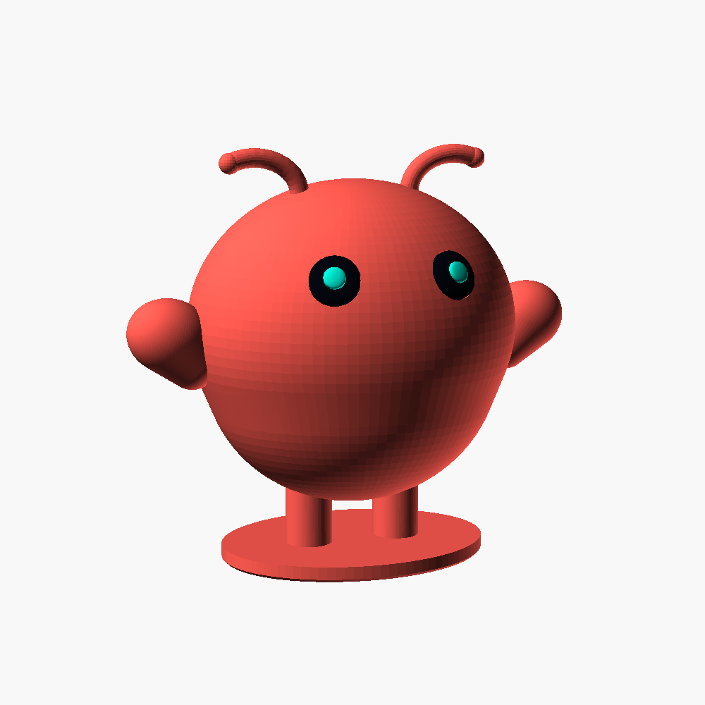

# OpenSCAD models

A collection of 3D printable models made in [OpenSCAD](https://openscad.org/).
Each model lives in its own directory with its own README.

| Model | Description |
|---|---|
| [rugged-box](rugged-box/) | Parametric rugged box with hinge, latches and seal. OpenSCAD port of [Rugged Box (Parametric)](https://www.printables.com/model/258431-rugged-box-parametric) by Whity |
| [openclaw-3d](openclaw-3d/) | Molty, the OpenClaw lobster mascot, as a desk figure. Single color or multicolor, support-free split version |

| Rugged box | OpenClaw |
|---|---|
|  |  |

## Licenses

Licenses differ between models. See the LICENSE file and license section in
each model's directory.

| Model | License |
|---|---|
| [rugged-box](rugged-box/) | [CC BY-NC-SA 4.0](rugged-box/LICENSE), the same license as the original work |
| [openclaw-3d](openclaw-3d/) | [CC BY 4.0](openclaw-3d/LICENSE) (the OpenClaw name and logo are not covered) |
