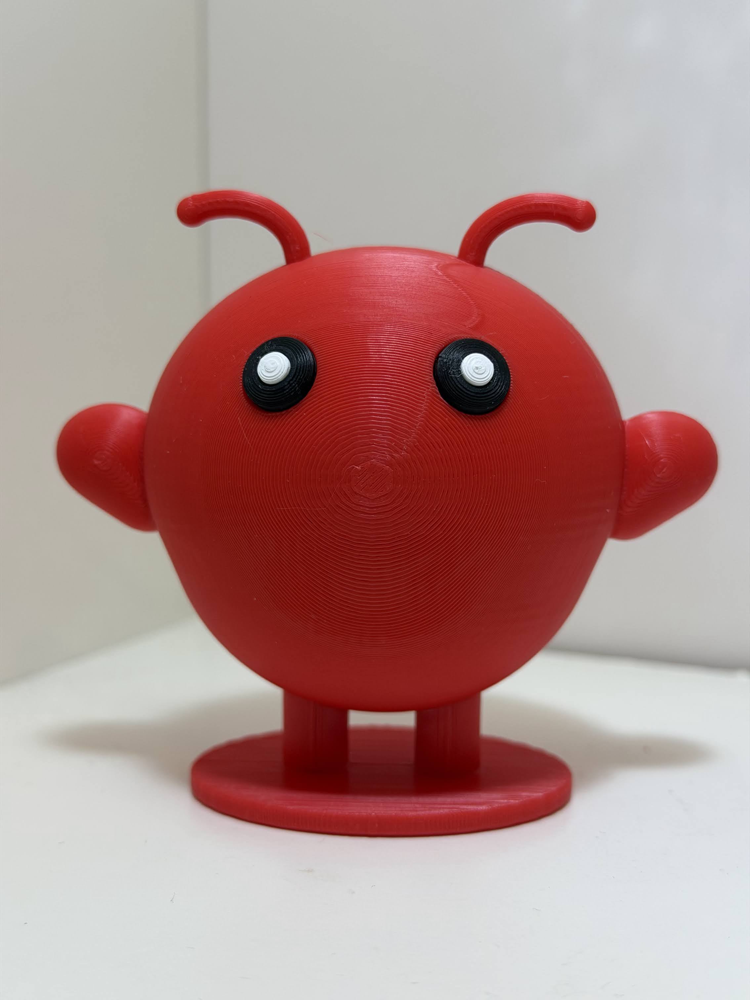

# OpenClaw mascot – 3D printable

A 3D version of the OpenClaw lobster mascot (`icon.png`), modeled in OpenSCAD.

| Printed | Model |
|---|---|
|  |  |

- Size: about 88 × 54 × 79 mm (W × D × H), standing on an oval base
- Colors (from <https://openclaws.io/logo/>): Claw Red `#FF5A50` body,
  Space Dark `#050810` eyes, Reef Teal `#00E5CC` pupils (white pupils work
  great too, as in the photo)

## Print options

All ready-to-print STLs are in `stl/`, one folder per option. Pick the one that
fits your printer.

| Option | Folder | Multicolor printer | Supports | Assembly |
|---|---|---|---|---|
| 1. Multicolor, one piece | `stl/multicolor-one-piece/` | yes | yes, under the body | none |
| 2. Multicolor, split | `stl/multicolor-split/` | yes | no | glue two halves |
| 3. Single color, split | `stl/single-color-split/` | no | no | glue two halves, eyes and pupils |

Option 2 or 3 gives the cleanest surface, since the round body never has to be
printed over supports.

### 1. Multicolor, one piece

Files: `openclaw_body.stl`, `openclaw_eyes.stl`, `openclaw_pupils.stl`

1. Load all three files at once and when the slicer asks, load them as a single
   object with multiple parts.
2. Assign filaments: body red, eyes black, pupils teal or white.
3. Enable supports (tree/organic supports work best on the round underside),
   at least under the body and the claws.

No assembly needed, but expect some support marks on the lower half of the body.

### 2. Multicolor, split in halves

Files: `openclaw_front.stl`, `openclaw_front_eyes.stl`,
`openclaw_front_pupils.stl`, `openclaw_back.stl`

1. Load `openclaw_front.stl`, `openclaw_front_eyes.stl` and
   `openclaw_front_pupils.stl` together as a single object with multiple
   parts. They are already positioned to match.
2. Assign filaments: front half red, eyes black, pupils teal or white.
3. Add `openclaw_back.stl` as a separate object (red).
4. Print without supports. Both halves lie on their flat cut face; the
   antennae are part of the front half and lie flat on the bed.
5. Assemble the halves, see [Assembly](#assembly).

### 3. Single color, split in halves

Files: `openclaw_front.stl`, `openclaw_back.stl`, `openclaw_eyes.stl`,
`openclaw_pupils.stl`

1. Print `openclaw_front.stl` and `openclaw_back.stl` in red, without supports.
2. Print `openclaw_eyes.stl` in black and `openclaw_pupils.stl` in teal or
   white. They
   print flat back down. The pupils are only 4 mm across, so print slowly and
   use a brim.
3. Glue each pupil into the pocket in an eye, then each eye into its recess in
   the face. A drop of CA (super) glue is enough; parts have a 0.15 mm gap
   for glue.
4. Assemble the halves, see [Assembly](#assembly).

## Assembly

The halves are aligned with four dowel pins made from 1.75 mm filament.

1. Cut four pieces of filament, about 13 mm long (holes are 7 mm deep on each
   side).
2. Push the pins into the holes in one half. The hole mouths are chamfered so
   first-layer squish doesn't block them.
3. Apply glue to the cut face, press the halves together and hold until set.

The antennae stick out of the front half, so take it off the bed carefully,
preferably by flexing the build plate rather than prying near the antennae.

## Tips

- If the pins are too tight, raise `pin_d` (e.g. to `2.1`) or turn on
  elephant's foot / first-layer compensation in your slicer.
- If glued eyes are too tight or too loose, adjust `glue_gap`.

## Customizing and re-exporting

Everything is parametric in [`openclaw.scad`](openclaw.scad); sizes and
clearances are named values at the top of the file. Open it in OpenSCAD to
preview (`part = "all"` shows the assembled model, `part = "plate"` shows the
split parts laid out for printing).

After changes, regenerate all STL folders with:

```sh
./export.sh
```

Requires [OpenSCAD](https://openscad.org/) on `PATH`.

## Publishing (Printables / MakerWorld)

Ready-to-paste text for model pages.

**Name**

```text
Molty – OpenClaw Lobster Mascot
```

**Summary**

```text
Molty, the OpenClaw space lobster mascot. Splits into two halves for support-free printing; single-color or multicolor.
```

**Description**

```text
Molty is the little space lobster mascot of OpenClaw, the open-source project. This is a 3D desk figure modeled using Opus 5.5 in OpenSCAD from the 2D mascot icon.

Size: about 88 × 54 × 79 mm, standing on an oval base.
Colors: red body, black eyes, teal or white pupils.

PRINT OPTIONS

The files come in three sets. Pick the one that fits your printer.

1) Single color, split: any printer
Files in `single-color-split`
- The front and back halves print flat on their cut face with no supports.
- The eyes (black) and pupils (teal or white) print as small flat pieces and glue into recesses in the face. Each piece has a 0.15 mm gap for glue.
- The pupils are only 4 mm across, so print them slowly if necessary use a brim.

2) Multicolor, split: AMS / MMU
Files in `multicolor-split`
- The same support-free halves.
- The eyes and pupils are pre-positioned to match the front half. Load the front half, eyes and pupils together as one multi-part object and assign the filaments.

3) Multicolor, one piece: AMS / MMU
Files in `multicolor-one-piece`
- Load the body, eyes and pupils as one multi-part object.
- Needs supports under the body; tree/organic supports work best.
- No assembly, but expect support marks on the lower half.

ASSEMBLY (split versions)

- Four 1.75 mm filament pieces act as dowel pins to align the halves. Cut them about 13 mm long; the holes are 7 mm deep on each side.
- The hole mouths are chamfered, so first-layer squish won't block the pins.
- Push the pins into one half, add CA glue to the cut face, and press the halves together.
- The antennae are part of the front half and print lying flat. Take that half off the bed carefully, ideally by flexing the build plate.

**Tags**

```text
openclaw, lobster, mascot, molty, desk toy, figure
```
