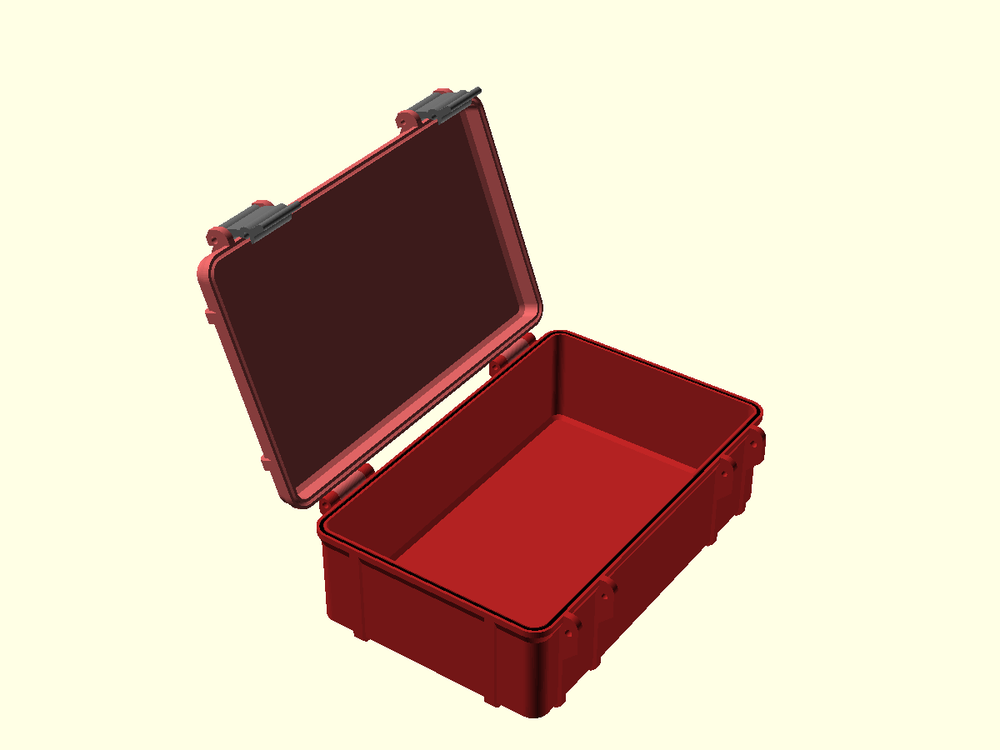

# Rugged Box (parametric, OpenSCAD)



An OpenSCAD version of
[Rugged Box (Parametric)](https://www.printables.com/model/258431-rugged-box-parametric)
by [Whity](https://www.printables.com/@Whity), ported from the original Fusion 360
design ("Rugged Box Parametric V2"). The geometry follows the Fusion model: the
same wall and lip profile, side ribs, hinge, latches, seal groove and seal. The
parameters keep the names of the Fusion user parameters, so the original
documentation still applies.

The small edge fillets of the Fusion model are not included.

## Parts

| Part | Count | Notes |
|---|---|---|
| `box` | 1 | Bottom part, prints as is |
| `lid` | 1 | Prints upside down (outer face on the bed) |
| `latch` | 2 | Prints flat |
| `seal` | 1 | Optional, print in TPU; sits in the groove of the box |

Hardware: 4× M3 screws, `ScrewLength` long (30 mm by default). Two hold the
hinge and two hold the latches to the lid. The latches snap onto the screw heads
on the box side.

## Usage

Open [`rugged_box.scad`](rugged_box.scad) in [OpenSCAD](https://openscad.org/)
and change the parameters in the Customizer (Window → Customizer).

The most important parameters are the inner dimensions:

| Parameter | Meaning |
|---|---|
| `InnerBoxWidth` | Inner width (hinge side) |
| `InnerBoxDepth` | Inner depth |
| `InnerBoxBottomHeight` | Inner height of the bottom part |
| `InnerBoxLidHeight` | Inner height of the lid (keep it at least about 8.5 mm) |

With the lid closed, the inner height is `InnerBoxBottomHeight + InnerBoxLidHeight`.
The outside of the box (lip and ribs) is about 8.5 mm larger than the inner
width and depth, and the hinge and latches stick out another 7 mm on the long
sides.

The `part` parameter selects what is rendered:

- `assembly` shows the assembled box; `lid_open_angle` opens the lid
- `box`, `lid`, `latch`, `seal` render a single part in its print orientation
- `print_plate` lays out all parts next to each other

### Exporting STLs

Export each part separately, for example:

```sh
openscad --backend=manifold -D 'part="box"' -o box.stl rugged_box.scad
openscad --backend=manifold -D 'part="lid"' -o lid.stl rugged_box.scad
openscad --backend=manifold -D 'part="latch"' -o latch.stl rugged_box.scad
openscad --backend=manifold -D 'part="seal"' -o seal.stl rugged_box.scad
```

Parameters can be overridden from the command line as well, for example
`-D InnerBoxWidth=180 -D InnerBoxDepth=110`.

The parts on the `print_plate` don't touch, so its STL can also be split in the
slicer (right-click → Split → To objects).

## License

This is a derivative of Whity's
[Rugged Box (Parametric)](https://www.printables.com/model/258431-rugged-box-parametric),
which is licensed under Creative Commons Attribution-NonCommercial-ShareAlike.
This version is released under the same license,
[CC BY-NC-SA 4.0](https://creativecommons.org/licenses/by-nc-sa/4.0/), see
[LICENSE](LICENSE). Non-commercial use only; derivatives must keep the
attribution and use the same license.
